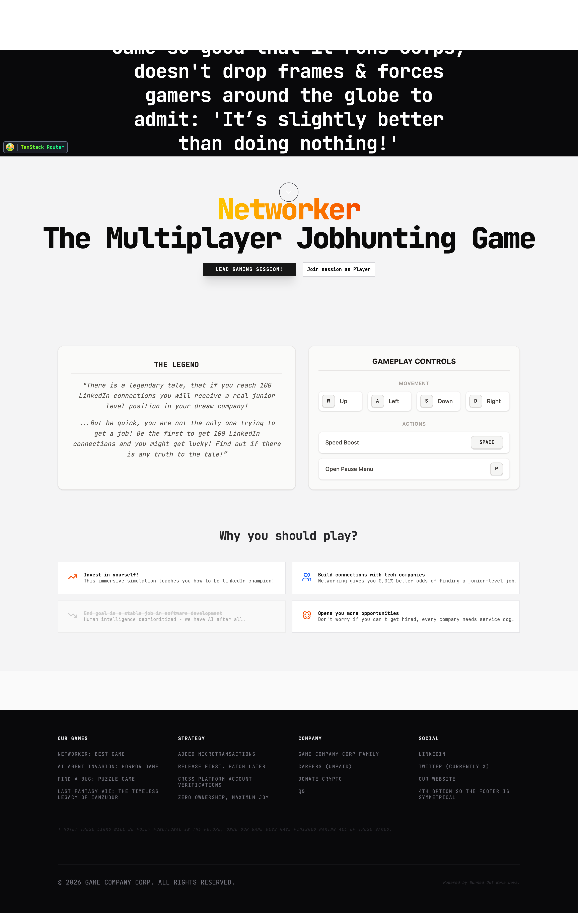
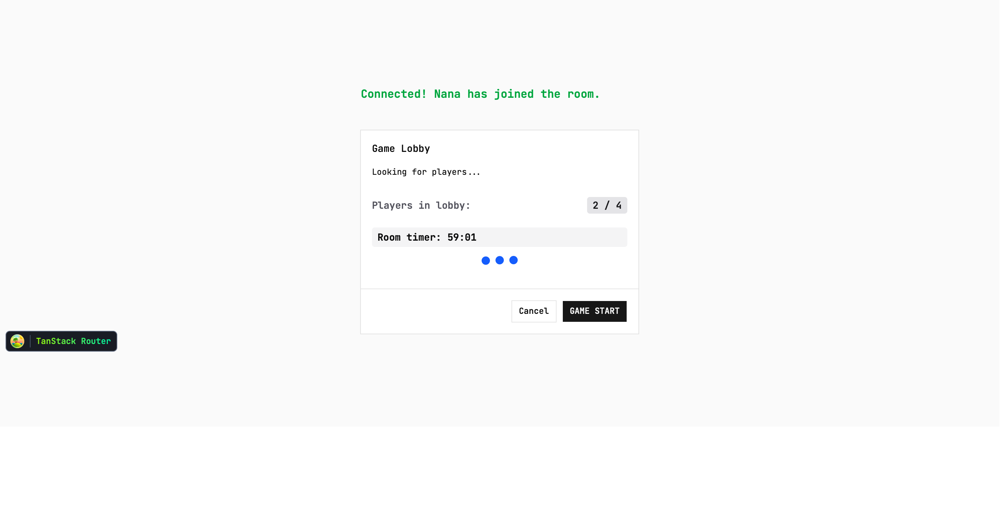
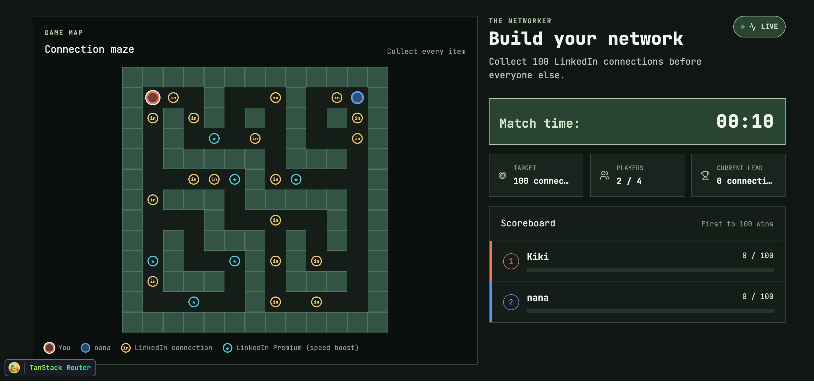
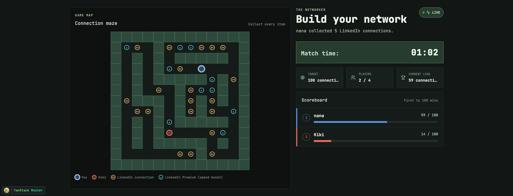
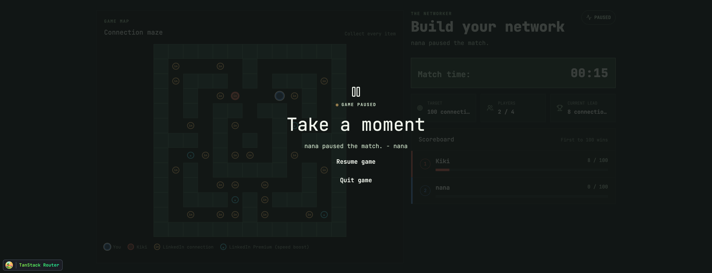
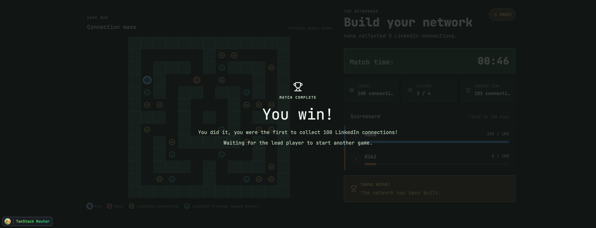
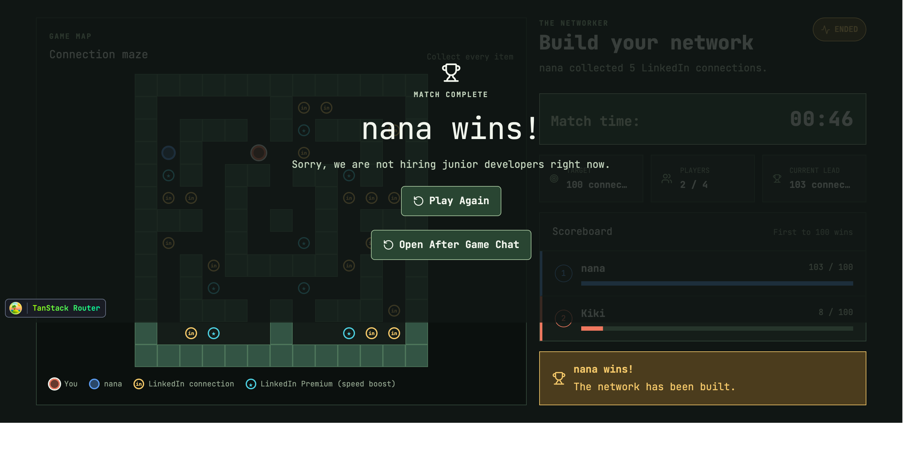

# The Networker

The Networker is a real-time, browser-based multiplayer resource-gathering game for 2-4 players. Each player controls a character in a DOM-rendered maze and collects LinkedIn connections. The first player to reach 100 connections wins the match.

## Project Overview

Players join a room with a unique username, wait in the lobby, and start a simultaneous real-time match. LinkedIn connection items are placed throughout the maze and award different numbers of connections when collected. Players can see the other players, their scores, the current leader, and the match timer while playing.

The match ends immediately when a player reaches 100 connections. The winning player sees a winner message and the other players see a losing message. The lead player can start a rematch after the match ends.

### Game rules

- The match supports 2-4 simultaneous players.
- Players move with the keyboard using `WASD` or the arrow keys.
- Players cannot move through maze walls.
- Players do not collide with one another.
- Regular connection items award 1 or 2 connections.
- LinkedIn Premium items award 5 connections and provide a temporary movement speed boost.
- The first player to reach 100 connections wins.
- The match timer counts upward while the match is active.
- A match with no activity for one minute ends automatically.


## Technology

- **Frontend:** React, TypeScript, Vite
- **Backend:** Node.js, Express, Socket.IO
- **State management:** Zustand
- **Rendering:** DOM elements and CSS transforms
- **Routing:** TanStack Router
- **Styling:** CSS and Tailwind/shadcn utilities already used in the project
- **Package manager:** npm
- **Public access:** Pinggy tunnel for development/demo sessions

## Requirements

- Node.js `20.19.0` or later in the Node 20 release line, or Node.js `22.12.0+`, is required.
- npm
- A modern browser such as Chrome, Firefox, or Edge
- For multiplayer testing over the internet, the host needs an internet connection that permits the Pinggy tunnel.

## Installation

Clone the repository and install dependencies for both workspaces:

```bash
git clone https://gitea.kood.tech/anssipeltoniemi/multi-player.git
cd multi-player

cd client
npm install

cd ../server
npm install
```

The client and server each have their own `package.json` and lockfile, so both dependency installations are required.

## Running Locally

### Local development

Start the server from the `server` directory:

```bash
cd server
npm run dev
```

Open:

```text
http://localhost:3000
```

The server runs in watch mode and serves the Vite client through the Node.js application.

### Production build with a public link

Build the client and start the server in production mode with a Pinggy tunnel:

```bash
cd server
npm run start:public
```

This command builds the client before starting the server. For final multiplayer and performance checks, prefer this build over the Vite development server.

## Share the Game with a Public Link (Pinggy)

In `server/`, run:

```bash
npm run dev:public
```

Create a room. The room screen displays both a **Game ID** and a **Game link** containing the Pinggy URL. Copy both values and send them to the other players.

They open the link, press the join button, then enter the Game ID and a username.

Notes:

- Free Pinggy tunnels are temporary and may last about 60 minutes.
- The public URL changes every time the tunnel restarts.
- Without `TUNNEL=1` (plain `npm run dev`), no tunnel is opened and the link shown is only the local address.
- The public link is intended for development and demonstrations, not permanent hosting.

## How to Play

### Lead player journey

1. Open the game and choose **Lead gaming session**.
2. Enter a unique username.
3. Open the room.
4. Share the room ID and public link.
5. Wait for 2-4 players to join.
6. Start the match from the lobby.
7. Collect connections and monitor the scoreboard.
8. Start a rematch from the end-game screen if desired.

### Joining player journey

1. Open the link supplied by the lead player.
2. Choose **Join session**.
3. Enter the room ID and a unique username.
4. Wait in the lobby.
5. Start moving when the lead player starts the match.

### Controls

| Action | Control |
| --- | --- |
| Move up | `W` or `Arrow Up` |
| Move down | `S` or `Arrow Down` |
| Move left | `A` or `Arrow Left` |
| Move right | `D` or `Arrow Right` |
| Dash | `Space` |
| Pause | `P` |
| Resume | Resume button in the pause overlay |
| Quit | Quit button in the in-game menu |

## Architecture and Data Flow

The project separates the game into four cooperating parts:

1. **DOM game engine:** Handles keyboard input, movement, collision checks, animation, and player transforms.
2. **Zustand client store:** Holds the latest server-approved game snapshot for the UI, game engine, and Socket.IO client.
3. **Socket.IO client:** Sends player actions and writes server updates into the client store.
4. **Node.js server:** Owns rooms, player connections, scores, active items, phases, timer state, pause/resume, and winner selection.

The client reports movement and collection attempts. The server checks collection requests against its current item state, applies score changes, and broadcasts the resulting match state. Movement rendering and wall collision run in the browser. This keeps scores and active items synchronized without putting per-frame animation into React.

Shared event and state names are documented in [`docs/shared-names.md`](docs/shared-names.md). 

## Project Structure

```text
.
├── client/
│   ├── public/                   # Static assets
│   └── src/
│       ├── components/networker/ # Maze, HUD, overlays, and sound effects
│       ├── components/ui/        # Reusable UI components
│       ├── lib/                  # Maps, game state, networking, and utilities
│       └── routes/               # Home, room, lobby, game, and chat pages
├── server/
│   └── src/
│       ├── game/                 # Authoritative game rules and state
│       ├── socket/               # Lobby, gameplay, chat, and disconnect events
│       └── utils/                # Room IDs and public-tunnel setup
├── docs/                         # Shared vocabulary and screenshots
├── docker-compose.yml
└── README.md
```

## Screenshots and User Journey Evidence


The current user-journey screenshots are:

### 1. Home screen

The entry screen presents the game and the options to lead or join a session.



### 2. Lobby

The lobby shows the room and the players waiting for the lead player to start.



### 3. Maze with players

The maze uses DOM elements for the walls, items, and player characters. Players are color-coded and can see one another in the same match.



### 4. Live match and scoreboard

The live game displays the maze, timer, player scores, current leader, and collection target.



### 5. Pause and system message

The pause overlay shows that the match has paused and identifies the current game state to all players.



### 6. Winner screen

The winner screen confirms the player who reached 100 connections first.



### 7. Loser screen

The other players receive a different message explaining that they did not win the match.




## Additional Features

The project currently includes features beyond the core requirement:

- Multiple tested maze layouts selected for different matches.
- LinkedIn Premium items with temporary speed boosts.
- Dash movement with a cooldown.
- Sound effects for collecting items, premium items, match start, pause, resume, winning, and losing.
- Current-leader display and animated scoreboard ranking.
- Rematch support for the lead player.
- One-minute inactivity timeout for matches with no player activity.
- Optional chat route for player communication.

## Verifying 60 FPS / No Dropped Frames

The assessment target is a constant minimum of 60 FPS with no noticeable dropped frames while playing. This section describes how to measure that target; it should not be treated as proof that every device and browser has already achieved it. A drop at the exact moment of switching browser tabs is acceptable, but drops that continue after switching back require investigation.

1. Build and run the production-style version.
2. Open the game in Chrome and start a match.
3. Open DevTools with `F12`.
4. Open the Command Menu with `Ctrl+Shift+P` on Windows/Linux or `Cmd+Shift+P` on macOS.
5. Run **Show frames per second (FPS) meter**.

Measure the game while players are moving, collecting items, and receiving network updates. On a 60 Hz display, the meter should remain close to 60 during active gameplay.

For actual proof, rather than only a live FPS reading:

1. Open DevTools → **Performance**.
2. Start recording with the record button.
3. Play normally for approximately 15 seconds: move, dash, collect items, pause, and resume.
4. Stop the recording.
5. Check the **Frames** lane. Every block should be solid green. Red or striped blocks indicate dropped frames.
6. Click a dropped frame and inspect the **Main** track underneath it to see what work caused the drop.

The FPS meter may read low when nothing on screen is changing because Chrome can skip unnecessary repaints. Judge performance during active movement and use the Performance recording to confirm whether frames were actually delayed.

The game uses `requestAnimationFrame` and elapsed timestamps for movement rendering. A 60 FPS target gives approximately 16.67 ms per frame, so use the Performance panel to identify whether time is being spent in JavaScript, layout, paint, or compositing.


## Troubleshooting

### Players cannot connect through the public link

Make sure `npm run dev:public` is still running. Free tunnel URLs expire and change after a restart.

### The game loads but the state is stale

Refresh the game page and confirm that the client is connected to the same server URL and room ID. The game route requests the current room state when it loads.

### The FPS meter is low during development

Test the production build with DevTools recording stopped. Development tooling, browser extensions, multiple game windows, and hardware acceleration settings can affect the result.
